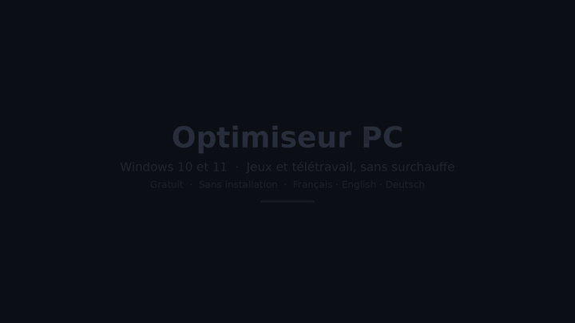

# Détecteur Caméra & Micro

Application web (fonctionne dans le navigateur du téléphone, sans rien installer) pour aider à repérer
les caméras cachées (mini caméras, micro-caméras, caméras infrarouges) et les micros.

**100 % gratuit, aucune bibliothèque externe, aucune donnée envoyée sur Internet.**
Les photos restent stockées sur le téléphone.

## Fonctions
- Ouvre la caméra arrière du téléphone et analyse l'image en direct (~15 fois/seconde).
- **Mode « Reflet d'objectif »** : avec la lampe allumée, repère les petits points brillants et ronds
  que renvoient les lentilles de caméra (murs, plafond, étagères, jouets, miroirs, objets…).
- **Mode « Infrarouge »** : dans le noir, repère les LED infrarouges des caméras de vision nocturne.
- **Photo automatique** dès qu'un point suspect reste visible plusieurs images de suite (cercle rouge + date).
- Bip + vibration à chaque alerte.
- Bouton 🔄 pour passer à la caméra avant (souvent meilleure pour l'infrarouge).
- **Détecteur magnétique** (si le téléphone le permet) pour les micros et circuits électroniques.
- Galerie des photos avec enregistrement et suppression.
- **Rapport de scan** : vérification d'un logement pièce par pièce (location, hôtel, bureau…),
  résultat par pièce, puis rapport daté avec photos à imprimer en PDF ou à partager (8 langues).

## Langues
Français, English, Deutsch, Español, Italiano, Português, Türkçe, العربية.
La langue du téléphone est choisie automatiquement ; elle peut être changée en haut à droite.
Pour ajouter une langue : copier le bloc `en` dans `app/i18n.js` et le traduire.

## Tester avant la mise en ligne
Ouvrir `detecteur-test.html` dans Google Chrome sur un ordinateur avec webcam.
Ce fichier contient toute l'application (il est régénéré avec `python3 tools/build-single.py`).

Tests automatiques : `node --test tests/*.test.js`

## Utilisation
La caméra ne fonctionne qu'en **HTTPS**. Le plus simple (gratuit) : activer **GitHub Pages**
(Settings → Pages → Branch → dossier `/`), puis ouvrir sur le téléphone :
`https://<votre-nom>.github.io/<dépôt>/app/`
Ensuite « Ajouter à l'écran d'accueil » pour l'utiliser comme une vraie application.

## Limites
Aucune application ne détecte 100 % des caméras ou micros. Des fausses alertes sont possibles
(vis brillantes, bijoux, gouttes d'eau). Vérifiez toujours chaque alerte à l'œil.

---

# Optimiseur PC (Windows 10 / 11)

▶ [Vidéo de démonstration 1.1 (1 min 31)](optimiseur-windows/demo/demo-optimiseur-pc.mp4)
Application séparée dans le dossier [`optimiseur-windows`](optimiseur-windows/README.md) : optimise Windows pour
les jeux et le télétravail sans surchauffe, retire les applications inutiles, chaque changement coché, confirmé et annulable.
Téléchargement : https://github.com/defege185-cpu/mein-erst-Projekt-/releases/latest — puis double-clic sur `Lancer-Optimiseur.bat`. Langues : français, anglais, allemand.
